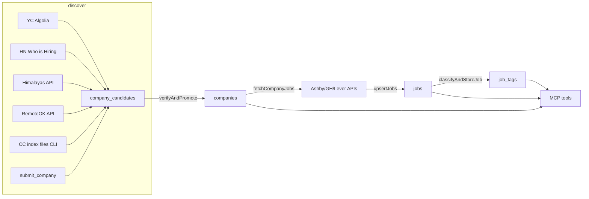

# CaniApply / jobfit — Project Brief

Factual snapshot for an engineer reviewing the repo and planning next steps. Based on reading the code and querying the local Postgres volume used by this workspace (`jobfit` DB via `caniapply-jobfit-pg`). **No secrets or env values.**

Generated: 2026-11-11.

---

## 1. Purpose

**CaniApply** (npm package `caniapply`, historically “jobfit”) is a Node 20 + Postgres pipeline that discovers companies with public ATS job boards (Ashby, Greenhouse, Lever), ingests open postings, classifies each job for **India remote eligibility** (rules first, optional free-tier LLM when unclear), and exposes the corpus via a **Model Context Protocol (MCP)** server (`search_jobs`, `get_job`, `list_companies`, `stats`, `submit_company`). A weekly discovery cron and a 6-hour ingest cron run under pg-boss; Common Crawl board discovery is a separate CLI (`discover:cc`).

---

## 2. Architecture

### Services

| Compose file | Role |
|---|---|
| `docker-compose.yml` | Local/simple: `postgres` (host `127.0.0.1:5435`), `mcp` (`127.0.0.1:3110→3100`), optional `caddy` profile `tls`. DB creds hard-coded `jobfit/jobfit`. |
| `docker-compose.prod.yml` | Prod Contabo: `postgres` (internal only), `migrate` (one-shot), `app` (`node dist/index.js` — worker), `mcp` (`node dist/mcp/http.js`, published `127.0.0.1:3110`), optional `caddy` (profile `tls`, `:80`/`:443`). |

Host nginx may also terminate TLS and proxy to `3110` (`infra/nginx/`). The Dockerfile default CMD is MCP HTTP; compose overrides for `app` / `migrate`.

### End-to-end data flow

1. **Discover** (`runDiscovery` / `runCommonCrawlDiscovery`) → upsert `company_candidates` (pending).
2. **Promote** (`verifyAndPromote`) → probe ATS job count, blocklist / size filters → insert `companies`, optional ingest.
3. **Ingest** (`fetchCompanyJobs` → `upsertJobs`) → write `jobs` + `fetch_runs`; jobs missing from board get `closed_at`.
4. **Classify** (rules → evidence guard → optional LLM) → upsert `job_tags`.
5. **MCP** reads open tech jobs (excludes `role_family = non_tech`) and serves eligibility-filtered search.

Worker entry: `src/index.ts` (ingest + classify + discover crons). MCP entry: `src/mcp/http.ts` or `src/mcp/stdio.ts`.

---

## 3. Folder / file map

| Path | One-line |
|---|---|
| `src/ats/` | ATS adapters (`ashby.ts`, `greenhouse.ts`, `lever.ts`) + `types.ts` / `index.ts`. |
| `src/classify/` | Eligibility rules, roles, guard, LLM providers, pg-boss classify workers. |
| `src/db/` | Drizzle `schema.ts`, `client.ts`, `migrate.ts`. |
| `src/discover/` | Sources, promote, blocklist, hardware filter, CC discovery, discover cron. |
| `src/ingestion/` | `fetch-company.ts`, `upsert.ts`, ingest pg-boss. |
| `src/mcp/` | HTTP/stdio MCP server, tools, schemas, rate limit, logging. |
| `src/scripts/` | One-shot CLIs (ingest, classify, discover, stats, seed, …). |
| `src/utils/` | `http.ts`, `hash.ts`, `html.ts`. |
| `src/config.ts` | Zod-parsed env (`config`). |
| `src/index.ts` | Long-running worker process. |
| `drizzle/` | SQL migrations `0000`…`0002` + `meta/_journal.json`. |
| `tests/` | Vitest unit (+ optional integration) tests. |
| `scripts/` | `smoke.sh`, `backup-postgres.sh`. |
| `infra/nginx/` | Host nginx sample for MCP domain. |
| `companies.yaml` | Seed companies + blocklist. |
| `docker-compose.yml` / `docker-compose.prod.yml` | Dev vs prod stacks. |
| `Dockerfile` | Multi-stage Node 20 build. |
| `Caddyfile` | TLS reverse proxy to `mcp:3100`. |
| `DEPLOY.md` | Prod deploy notes. |
| `.github/workflows/` | `ci.yml`, `deploy.yml`. |
| `.cache/cc/` | Cached Common Crawl CDX byte-range slices (local; gitignored ideally). |
| `logs/` | Local run logs (not part of product). |
| `README.md` | Human overview. |
| `PROJECT_BRIEF.md` | This document. |

---

## 4. Database

Schema: `src/db/schema.ts`. Client: `src/db/client.ts` (node-postgres + drizzle). Migrate: `src/db/migrate.ts` → `drizzle-orm/node-postgres/migrator`.

### Enums

- `ats`: `ashby | greenhouse | lever | workable | recruitee | personio` — **only first three have adapters**.
- `candidate_status`: `pending | verified | rejected`.

### Tables

#### `companies`
| Column | Type | Notes |
|---|---|---|
| `id` | uuid PK | |
| `name` | text | |
| `website` | text | |
| `ats` | ats enum | |
| `ats_slug` | text | Board slug |
| `active` | bool default true | |
| `created_at` | timestamptz | |

Indexes: unique `(ats, ats_slug)`, index `active`.  
**Writes:** `promote.ts` insert/upsert; `deactivateBlocklistedCompanies`; seed script.  
**Reads:** ingest, MCP `list_companies`/`stats`, classify joins.

#### `jobs`
| Column | Notes |
|---|---|
| `id`, `company_id` FK cascade | |
| `external_id` | ATS job id |
| `title`, `department`, `location_raw`, `is_remote_flag`, `employment_type` | |
| `description_text`, `apply_url` | |
| `compensation_raw` | jsonb (Ashby may populate) |
| `posted_at`, `source_ats`, `content_hash` | |
| `first_seen_at`, `last_seen_at`, `closed_at`, `updated_at` | |

Indexes: unique `(company_id, external_id)`, `closed_at`, `posted_at`, `content_hash`.  
**Writes:** `upsertJobs`. **Reads:** classify, MCP, stats.

#### `fetch_runs`
Per-company ingest attempt: `started_at`, `finished_at`, `ok`, `job_count`, `error`.  
**Writes:** `fetchCompanyJobs`. **Reads:** MCP `stats` (last ok ingest).

#### `company_candidates`
Discovery queue: `name`, `domain`, `source`, `status`, `ats`, `ats_slug`, `evidence_url`, `job_count`, `reject_reason`, `promoted_company_id`, timestamps.  
Unique `(source, name)`.  
**Writes:** `upsertCandidates`, `submitCompany` (MCP), promote updates.  
**Reads:** promote, discover status scripts.

#### `job_tags`
1:1 with `jobs` by `job_id` PK. Eligibility + interview + compensation + `role_family` + `classifier`/`model`/`classified_at`/`content_hash`.  
Comment in schema still says “Reserved for phase 2 — classification” but **classification is fully implemented and writing this table**.  
**Writes:** `classifyAndStoreJob`. **Reads:** MCP, stats, enqueue unclear jobs.

#### `company_research`
Funding/headcount/India presence/news/interview reports + `expires_at`.  
**No application writers found** — schema-only / unused.

#### `ats_board_checks`
CC probe cache: `(ats, slug)` unique, `status` (`valid|not_found|empty|error`), `job_count`, `checked_at`, `error`.  
**Writes/reads:** `cc-validate.ts` (7-day freshness).

### Migrations (order)

1. `drizzle/0000_colorful_the_order.sql` — base enums + `companies`/`jobs`/`fetch_runs`/`job_tags`/`company_research`.
2. `drizzle/0001_company_candidates.sql` — candidates table + enum.
3. `drizzle/0002_ats_board_checks.sql` — board check cache.

Journal: `drizzle/meta/_journal.json`.

---

## 5. Ingestion

### Adapters (`src/ats/`)

| ATS | Class | Endpoint | Key field mapping |
|---|---|---|---|
| **Ashby** | `AshbyAdapter` | `GET https://api.ashbyhq.com/posting-api/job-board/{slug}?includeCompensation=true` | `id→externalId`, title, dept/team, locationName/location, isRemote, employmentType, descriptionPlain/Html, applyUrl/jobUrl, publishedAt, compensation |
| **Greenhouse** | `GreenhouseAdapter` | `GET https://boards-api.greenhouse.io/v1/boards/{slug}/jobs?content=true` | `id`, title, departments, location.name, content (HTML stripped), absolute_url, updated_at; remote inferred from location/offices text |
| **Lever** | `LeverAdapter` | `GET https://api.lever.co/v0/postings/{slug}?mode=json` | `id`, `text`→title, categories (dept/location/commitment), description(+additional), hostedUrl, createdAt, workplaceType |

`getAdapter()` throws for `workable` / `recruitee` / `personio` (“not implemented yet”).

### Closed jobs

`upsertJobs` (`src/ingestion/upsert.ts`): upsert all fetched rows with `closed_at = NULL` and `last_seen_at = now`; then **any previously open job for that company whose `external_id` is not in the fetch set** gets `closed_at = now`. Empty board closes all open jobs for the company.

### Schedule

- Cron queue `ingest-schedule`: `INGEST_CRON` default `0 */6 * * *` UTC (`scheduleIngestCron`).
- Handler enqueues every `companies.active` row onto `ingest-company` with `singletonKey = companyId`.
- Concurrency: `INGEST_CONCURRENCY` (default 5). Per-job timeout: `INGEST_COMPANY_TIMEOUT_MS` (default 30s) + pg-boss expire.
- Retries: pg-boss `retryLimit: 3`, `retryDelay: 30`, `retryBackoff: true`.
- After successful ingest: `enqueueJobsNeedingClassification` → `classify-job` queue.

HTTP: shared `fetchJson` with `USER_AGENT`, `HTTP_TIMEOUT_MS`, `PER_HOST_DELAY_MS`.

---

## 6. Discovery

### Weekly cron sources (`runDiscovery` in `src/discover/run.ts`)

Default sources: **`yc`, `hn_hiring`, `himalayas`, `remoteok`**. (`common_crawl` is **not** in the weekly set.)

| Source | File | How it finds companies / ATS |
|---|---|---|
| **yc** | `sources/yc.ts` | YC Algolia `YCCompany_production` (public search key or `YC_ALGOLIA_API_KEY`). Drops hardware/manufacturing via `isHardwareManufacturing`. Domain from website. |
| **hn_hiring** | `sources/hn.ts` | HN Algolia “Who is hiring” threads; parses comment first-line company names; `extractAtsUrls` on HTML for Greenhouse/Lever/Ashby. |
| **himalayas** | `sources/himalayas.ts` | Himalayas jobs API; company from `companyName`; ATS from `extractAtsUrls` on description/applicationLink. |
| **remoteok** | `sources/remoteok.ts` | `https://remoteok.com/api`; ATS from URLs in job fields. |

### Common Crawl (`discover:cc` CLI)

- `src/discover/sources/common-crawl.ts` + `cc-validate.ts` + `run-cc.ts` + `scripts/discover-cc.ts`.
- Pulls CDX **byte ranges** from `data.commoncrawl.org` (known offsets for latest crawl; `cluster.idx`-derived). Public `index.commoncrawl.org` query API is too flaky for bulk wildcards — code documents this and uses index files instead.
- Patterns covered: `boards.greenhouse.io/*`, `job-boards.greenhouse.io/*`, `jobs.lever.co/*`, `jobs.ashbyhq.com/*`.
- Junk slug filter (`embed`, `api`, `assets`, …); validate via public jobs APIs; cache in `ats_board_checks` (skip if checked &lt; 7 days); then same `upsertCandidates` → `verifyAndPromote` path (**does not bypass filters**).

### Filters & promote rules (`promote.ts`, `hardware.ts`, `blocklist.ts`, `types.ts`)

| Filter | Where | Behavior |
|---|---|---|
| Hardware / manufacturing | YC discover only | Drop before candidate upsert |
| Blocklist | `companies.yaml` `blocklist` + `active: false` companies | Reject promote: `blocklisted in companies.yaml`; also deactivate matching live companies |
| Job count &lt; 1 | promote | `ATS board has 0 open jobs` |
| Job count &gt; 150 | `MAX_JOBS_FOR_PROMOTE` | `too many jobs (N > 150)` |
| No ATS | promote after URL extract + `detectAtsByGuess` | `no ATS board found` |
| Tech-only | **Not at discover** | At classify: `role_family=non_tech` excluded from MCP/stats/LLM unclear queue |

Auto-promote: pending → verify ATS → insert `companies` on `(ats, ats_slug)` → status `verified` + optional ingest+rules classify.  
MCP `submit_company` uses source `mcp_submit` and **explicitly does not auto-promote**.

### Candidate reject reasons (live DB, all sources, `status=rejected`)

| Reason | Count |
|---|---|
| no ATS board found | 577 |
| too many jobs (&gt;150) | 139 |
| ATS board has 0 open jobs | 36 |
| compensation int overflow | 4 |
| blocklisted in companies.yaml | 2 |

---

## 7. Classification

Entry: `classifyAndStoreJob` / `classifyJobContent` in `src/classify/classify.ts`.  
Rules: `classifyWithRules` (`rules.ts`) → calls `classifyIndiaEligibility` (`eligibility.ts`) + roles/seniority/interview/contractor/compensation.  
Then `guardEvidence` (`guard.ts`). Then optional LLM if unclear + tech role.

### India eligibility labels (`types.ts`)

`open | india_remote | india_onsite | region_locked | unclear`

### Rules order (`classifyIndiaEligibility`)

1. Strip HTML; **`stripBenefitsSections`** (drop Benefits/Perks headings so perk bullets cannot become open evidence).
2. **`classifyLocationRaw(location_raw)`** — India cities → india_remote/onsite; bare Remote → ignore; LOCATION_OPEN without specific geo → open; named region / locked geo → region_locked.
3. Title geo (`TITLE_COUNTRY_CODE`, `TITLE_GEO_PIPE`, SPECIFIC_GEO) can force region_locked even if location says Anywhere.
4. If geo lock: only **`STRONG_HIRE_ANYWHERE`** may override to `open` (never perk phrases); hard `REGION_LOCKED_PHRASES` still win.
5. Scan corpus for `REGION_LOCKED_PHRASES` (US auth, US/UK/EU only, timezone overlap without IST exception, …).
6. `CONTRACTOR_OPEN` (Deel/Remote.com/Oyster/EOR/contractor) → `open` if no geo lock.
7. `OPEN_INDIA` patterns with apply/hiring context → india_remote/onsite.
8. Strong then weak hire-anywhere; then generic worldwide/global **only with hiring-location context** (`HIRING_LOCATION_CONTEXT`), excluding marketing (`ELIGIBILITY_NEGATIVE_PHRASES`).
9. Else `unclear`.

### Named regex / phrase groups (source of truth: `src/classify/eligibility.ts`)

| Constant | Role |
|---|---|
| `ELIGIBILITY_NEGATIVE_PHRASES` | Marketing “global team/customers worldwide” — never open evidence |
| `HIRING_LOCATION_CONTEXT` / `APPLY_CONTEXT` | remote, hire, candidates, authorized to work, … |
| `REGION_LOCKED_PHRASES` | US/UK/EU-only, visa, must reside, PST/EST overlap, … |
| `SPECIFIC_GEO` | Large set of countries/cities/regions (US, UK, EU cities, APAC, LATAM, …) |
| `STRONG_HIRE_ANYWHERE` | “we hire in any country”, “candidates based anywhere”, … |
| `WEAK_OPEN_ANYWHERE` | “work from anywhere”, “remote worldwide”, … (no geo override) |
| `PERK_ANYWHERE_PHRASES` | “work from anywhere policy”, “N weeks of WFA”, … |
| `OPEN_INDIA` | India / IST / Bengaluru / Mumbai / … |
| `CONTRACTOR_OPEN` | contractor / Deel / EOR |
| `REGION_REMOTE_NAMED` | `Remote - APAC|EMEA|…` |

Full lists are in that file (~750 lines); do not duplicate ad hoc.

### Roles / tech gate (`roles.ts`)

Title patterns → `role_family` including `non_tech` (sales, marketing, HR, legal, …).  
`isTechRole`: anything except `non_tech` (null treated as tech until classified).  
MCP/stats filter: `role_family IS NULL OR <> 'non_tech'`.

### Evidence guard (`guard.ts`)

Whitespace-normalized evidence must be a **substring** of `title + Location: … + description`. Invalid decisive eligibility → demote to `unclear`. Same for interview style quotes and compensation evidence.

### `content_hash` cache

Job hash: title + description + location + employmentType + applyUrl (`utils/hash.ts`).  
`job_tags.content_hash` matched → return cached tags (`classifier: "cache"`) unless `force`.

### LLM pass

- Providers: rotation from `LLM_PROVIDERS` (`ollama`, `groq`, `gemini`, `openrouter`) via `classify/llm/rotation.ts` + per-provider modules; state in `LLM_STATE_PATH` (daily exhaustion).
- Runs when rules leave `india_eligibility=unclear` **and** role is tech (`llmOnlyIfUnclear` in workers).
- Rate: `TokenBucket(LLM_RPM)` default 30; worker concurrency `CLASSIFY_CONCURRENCY` default 4.
- Schema: `LlmClassificationSchema` — eligibility + evidence quotes (+ optional remote_scope); merge only overwrites unclear India fields.
- If all providers exhausted: keep rules (`unclear`), do not fail the job.

### Cross-check

Guard after merge; negative eligibility sentences stripped from LLM evidence (`isNegativeEligibilitySentence`).

---

## 8. MCP server

| Item | Detail |
|---|---|
| Transports | **Streamable HTTP** (`src/mcp/http.ts` + `app.ts`): `POST/GET /mcp`, `GET /health`. **stdio** (`src/mcp/stdio.ts`). |
| Server factory | `createCaniApplyMcpServer` in `server.ts` |
| Rate limit | `IpRateLimiter` — `MCP_RATE_LIMIT_RPM` (default 60) per IP sliding 60s window on `/mcp` |
| Logging | `logToolCall` — tool name, latency, result count, ok |

### Tools

| Tool | Input (`schemas.ts`) | Output shape (summary) |
|---|---|---|
| `search_jobs` | `query?`, `eligibility[]` default `[open,india_remote]`, `role_keywords?`, `company?`, `posted_within_days?`, `limit` 1–50 default 20, `cursor?` | `{ results: [{id,title,company,location,eligibility,evidence,apply_url,posted_at,last_seen_at}], next_cursor, count }` |
| `get_job` | `{ id: uuid }` | `{ found, job: {…eligibility, evidence, remote_scope, interview_*, compensation, description_excerpt, classification_source, …} }` |
| `list_companies` | `query?`, `ats?`, `limit` default 25 | `{ companies: [{id,name,website,ats,ats_slug,open_job_count,india_eligible_count}], count }` |
| `stats` | `{}` | `{ companies_active, tech_open_jobs, by_eligibility, last_ingestion_at }` |
| `submit_company` | `{ name, careers_url }` | `{ ok, deduped, candidate_id, status, message }` — queues `mcp_submit`, no auto-promote |

---

## 9. Jobs / scheduling (pg-boss)

Connection: `DATABASE_URL`. Boss created in `ingestion/boss.ts` (`createBoss`).

| Queue | Cron / trigger | Handler | Retry |
|---|---|---|---|
| `ingest-schedule` | `INGEST_CRON` (`0 */6 * * *` UTC) | `enqueueActiveCompanies` | schedule only |
| `ingest-company` | enqueued per active company | `fetchCompanyJobs` + enqueue classify | retryLimit 3, delay 30s, backoff; singleton per company |
| `classify-job` | after ingest / scripts | `classifyAndStoreJob` | inherits boss defaults; LLM has its own retry/exhaustion |
| `discover-schedule` | `DISCOVER_CRON` (`0 6 * * 1` UTC = Mondays 06:00) | sends `discover-companies` | |
| `discover-companies` | from schedule or manual | `runDiscovery` (YC/HN/Himalayas/RemoteOK + promote) | |

**Not scheduled:** `discover:cc` (CLI only).

---

## 10. Deploy + CI/CD

### Prod compose (`docker-compose.prod.yml`)

Services: `postgres` → `migrate` → `app` + `mcp`; optional `caddy` (`profiles: [tls]`). MCP published to host `127.0.0.1:3110`. Volumes: `caniapply_pgdata`, `caniapply_appdata`, caddy data/config.

### Caddy

`Caddyfile`: host `$MCP_HOST`; `/health` and `/mcp*` → `mcp:3100`.

### Env var **names** (from `.env.example` / `config.ts`)

`DATABASE_URL`, `POSTGRES_USER`, `POSTGRES_PASSWORD`, `POSTGRES_DB`, `MCP_HOST`, `MCP_DOMAIN`, `MCP_PUBLIC_URL`, `MCP_HTTP_PORT`, `MCP_RATE_LIMIT_RPM`, `USER_AGENT`, `HTTP_TIMEOUT_MS`, `PER_HOST_DELAY_MS`, `INGEST_CRON`, `INGEST_CONCURRENCY`, `INGEST_COMPANY_TIMEOUT_MS`, `LLM_PROVIDERS`, `LLM_PROVIDER`, `OLLAMA_URL`, `OLLAMA_MODEL`, `GROQ_API_KEY`, `GROQ_MODEL`, `GEMINI_API_KEY`, `GEMINI_MODEL`, `OPENROUTER_API_KEY`, `OPENROUTER_MODEL`, `CLASSIFY_CONCURRENCY`, `LLM_RPM`, `LLM_STATE_PATH`, `SEARCH_PROVIDER`, `SEARXNG_URL`, `TAVILY_API_KEY`, `BRAVE_API_KEY`, `DISCOVER_CRON`, `DISCOVER_PROMOTE_LIMIT`, `DISCOVER_PROMOTE_CONCURRENCY`, `YC_ALGOLIA_API_KEY`.

Search-provider keys are config-parsed but **company research is unused** — no runtime consumer found.

### GitHub Actions

- **`ci.yml`**: on PR/push to main/master — `npm ci`, `tsc --noEmit`, `npm test`.
- **`deploy.yml`**: after tests, SSH to VPS (`VPS_HOST`, `VPS_USER`, `VPS_SSH_KEY`, `VPS_DEPLOY_PATH`), git fetch with `GITHUB_TOKEN`, `docker compose -f docker-compose.prod.yml up -d --build`; optional smoke via `MCP_SMOKE_URL`.

### Smoke / backup

- `scripts/smoke.sh <base-url>` — health + MCP tool smoke.
- `scripts/backup-postgres.sh` — `pg_dump` gzip, keep 7 days (intended host cron).

---

## 11. Tests

- **19** test files under `tests/`; roughly **~80** `it`/`test` cases (`vitest run`).
- Areas covered: ATS normalizers (ashby/greenhouse/lever), eligibility/rules/roles/guard/llm helpers, discover URL/slug/hardware/sources/CC helpers, ingest upsert, MCP schemas/tools/rate-limit, detect-ats, optional integration ingestion.
- **Not covered / thin:** full promote against live ATS, pg-boss cron wiring, MCP HTTP transport E2E, Common Crawl network path, company_research, workable/recruitee/personio adapters, deploy scripts, compensation integer overflow on promote path, end-to-end discover→MCP.

Integration: `npm run test:integration` (`vitest.integration.config.ts`) — separate from default CI.

---

## 12. Live numbers

Queried 2026-11-11 against local `jobfit` DB (workspace volume). Prod Contabo DB may differ.

| Metric | Value |
|---|---|
| Companies active / inactive | **2213** / 7 |
| Candidates pending / verified / rejected | **886** / 2253 / 758 |
| Tech open jobs | **29140** |
| Last successful ingest (`fetch_runs.ok`) | **2026-11-11 11:55:12 UTC** |

### By eligibility (tech open)

| eligibility | n |
|---|---|
| region_locked | 19781 |
| unclear | 6839 |
| india_onsite | 1648 |
| open | 614 |
| india_remote | 236 |
| (untagged) | 22 |

### By ATS (companies)

| ats | total | active |
|---|---|---|
| greenhouse | 1719 | 1715 |
| ashby | 295 | 293 |
| lever | 206 | 205 |

### Candidates by discovery source × status

| source | pending | verified | rejected |
|---|---|---|---|
| common_crawl | 0 | 1869 | 139 |
| yc | 489 | 382 | 619 |
| hn_hiring | 235 | — | — |
| remoteok | 88 | 2 | — |
| himalayas | 69 | — | — |
| mcp_submit | 5 | — | — |

### Top 15 companies by open job count

| name | ats | open_jobs |
|---|---|---|
| Scale AI | greenhouse | 169 |
| Cookunity (greenhouse) | greenhouse | 150 |
| Anaplan (greenhouse) | greenhouse | 149 |
| Anthromededucation (greenhouse) | greenhouse | 149 |
| Aegworldwide (greenhouse) | greenhouse | 148 |
| 42northdental (greenhouse) | greenhouse | 147 |
| Oldcastlebuildingenvelope (greenhouse) | greenhouse | 145 |
| Klaviyo (greenhouse) | greenhouse | 145 |
| Muonspace (greenhouse) | greenhouse | 143 |
| Welbehealth (greenhouse) | greenhouse | 143 |
| Ninjavan (lever) | lever | 143 |
| Summittherapeutics (greenhouse) | greenhouse | 142 |
| Gotion (greenhouse) | greenhouse | 142 |
| Figma (greenhouse) | greenhouse | 142 |
| Datavant2 (greenhouse) | greenhouse | 141 |

Note: many CC-promoted names are slug-humanized with `(greenhouse)` suffix from `hitsToDiscovered`.

---

## 13. Known issues / TODOs / hacks

From code review + `TODO|FIXME|@deprecated|not implemented|Reserved`:

1. **ATS enum includes workable/recruitee/personio** but `getAdapter` throws — no implementations (`src/ats/index.ts`).
2. **`company_research` table unused** — schema comment “phase 2”; no writers in `src/`.
3. **`job_tags` schema comment still says “Reserved for phase 2”** though classification is live — comment stale.
4. **Search provider config** (`SEARCH_PROVIDER`, Tavily/Brave/Searx) unused by app logic.
5. **Compensation parse → DB integer overflow** — promote/classify can fail with `value "…" is out of range for type integer` (4 rejected candidates).
6. **CC discovery** uses hardcoded CDX byte ranges for one crawl; second crawl fill is mostly a no-op; public CDX query abandoned due to 504s.
7. **Weekly discover does not run `common_crawl`**; CC is CLI-only.
8. **`mcp_submit` source** not in `DiscoverSource` TypeScript union (string still stored).
9. **Hardware filter only on YC**, not on HN/Himalayas/RemoteOK/CC.
10. **Tech filter is post-ingest classification**, so non-tech jobs are still stored and counted in raw `jobs`.
11. **Promote limit** cron default 300 can leave large pending backlogs (currently hundreds of YC/HN/… pending).
12. **Deprecated env**: `LLM_PROVIDER`, `MCP_DOMAIN` (prefer `LLM_PROVIDERS`, `MCP_HOST`).
13. **YC Algolia default key** embedded in source (public frontend key; may rotate) — `sources/yc.ts`.
14. **`promote-pending.ts`** exists but is **not** wired in `package.json` scripts.
15. Dual compose naming (`jobfit` vs `caniapply`) — easy to point scripts at the wrong volume/DB.

No `TODO`/`FIXME` comments beyond the above patterns.

---

## 14. Scripts

### npm (`package.json`)

| Script | Description |
|---|---|
| `build` | `tsc` compile to `dist/` |
| `dev` | Watch worker (`src/index.ts`) |
| `start` | Run compiled worker |
| `db:generate` | Drizzle kit generate migrations |
| `db:migrate` | Apply migrations |
| `db:seed` | Seed companies from `companies.yaml` |
| `detect-ats` | Probe ATS for seed/list companies |
| `ingest:once` | One-shot ingest active companies |
| `classify:once` | Classify needing tags (with LLM if configured) |
| `classify:fast` | Faster/rules-oriented classify pass |
| `reclassify:open` | Reclassify open jobs |
| `llm:status` | Show LLM rotation / exhaustion state |
| `audit:sample` | Sample audit of classifications |
| `stats` | Print eligibility/corpus stats |
| `discover:once` | Run YC/HN/Himalayas/RemoteOK + promote |
| `discover:status` | Candidate queue status |
| `discover:cc` | Common Crawl slug discovery + validate + promote |
| `mcp:http` | MCP Streamable HTTP server |
| `mcp:stdio` | MCP stdio transport |
| `mcp:smoke` | Local MCP smoke script |
| `smoke` | `scripts/smoke.sh` against a base URL |
| `test` | Vitest unit tests |
| `test:watch` | Vitest watch |
| `test:integration` | Integration vitest config |

### Other CLIs (tsx paths, not all in package.json)

| Command | Description |
|---|---|
| `tsx src/scripts/reclassify-open-eligibility.ts` | Re-run eligibility on open jobs |
| `tsx src/scripts/deactivate-blocklist.ts` | Deactivate blocklisted companies |
| `tsx src/scripts/promote-pending.ts [limit]` | Drain pending candidates via promote (unwired) |
| `bash scripts/backup-postgres.sh` | Dump Postgres to gzip (VPS) |
| `bash scripts/smoke.sh <url>` | Deployed MCP health/tools check |

### `discover:cc` flags

- `--limit N` or `--limit=N` (default 2000)
- `--dry-run` — discover + validate (cache), skip upsert/promote
- `--promote-limit N` — optional cap on promote

---

## Suggested next-step questions (for the reviewing engineer)

Not commitments — gaps the code itself surfaces:

- Should weekly cron include CC or a promote-only drain of pending YC/HN?
- Cap or soft-reject boards near 150 jobs earlier in CC validate?
- Fix compensation integer bounds before insert?
- Implement or remove unused ATS enum values / `company_research` / search-provider config?
- Align naming (`jobfit` vs `caniapply`) across compose and docs?
