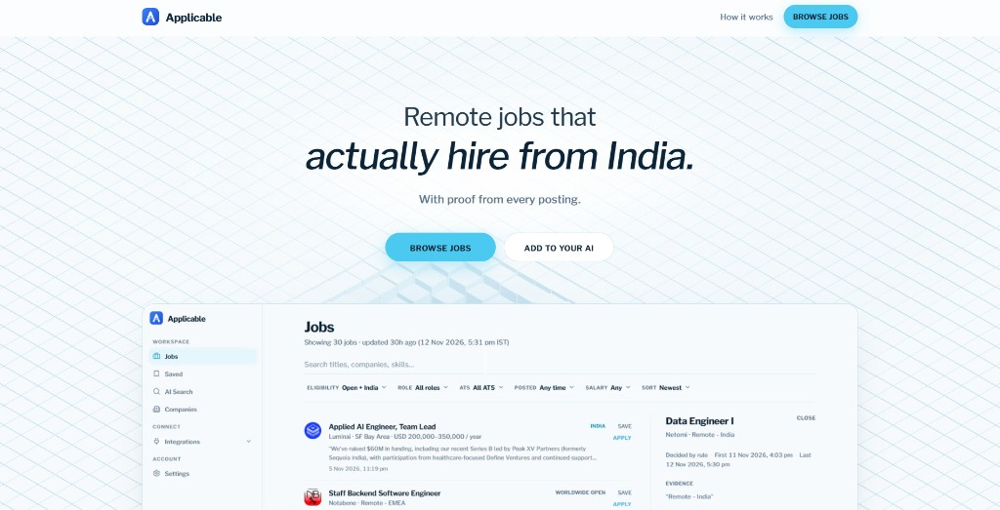

# Applicable

**Can I apply from India?**

Live remote tech jobs, labeled for India eligibility, with the exact line from the posting that proves it.

[](https://applicable.click)

- **Web:** [applicable.click](https://applicable.click)
- **MCP:** [mcp.applicable.click](https://mcp.applicable.click)
- **Waitlist:** [joinwaitlist.parthkadam.tech](https://joinwaitlist.parthkadam.tech)

## Live corpus

| Metric | Value |
|---|---|
| Companies tracked | **718** |
| Open tech roles | **15,079** |
| Remote from India | **101** |
| Open worldwide | **50** |
| India onsite | **339** |
| Graph | HydraDB · ~7.2k nodes · ~24.7k edges |

Same numbers power the landing page via `GET https://mcp.applicable.click/api/stats`.

## What it is

Applicable ingests public ATS boards (Ashby, Greenhouse, Lever, SmartRecruiters, Workable), stores postings in **Postgres**, classifies India eligibility with rules (+ LLM when unclear), and syncs a skills/company **graph into HydraDB**.

Browse on the site, or ask an agent over MCP: `search_jobs`, `get_job`, `get_company`, `stats`, `ask_jobs`, and more.

## Connect the MCP (30 seconds)

**Cursor** — Settings → MCP → Add server:

```json
{
  "mcpServers": {
    "applicable": {
      "url": "https://mcp.applicable.click"
    }
  }
}
```

**Claude** — custom connector URL: `https://mcp.applicable.click`

**Health check**

```bash
curl -s https://mcp.applicable.click/health
```

Public REST (same data as the landing stats/feed): `/api/stats`, `/api/jobs`, `/api/companies/top`.

## Architecture

```
ATS boards ──ingest──▶ Postgres ──classify──▶ job_tags
                 │                      │
                 │                      └──sync──▶ HydraDB graph
                 │
                 ├── MCP (mcp.applicable.click)
                 └── Next.js web (applicable.click)
```

- **Postgres** is the source of truth for jobs, companies, and eligibility labels.
- **HydraDB** is the graph used by `ask_jobs` / skill matching (falls back to search when the graph is off).
- Non-tech noise is kept in the DB as `role_family=non_tech` and excluded from tech search by default.

## Local development

```bash
cp .env.example .env
docker compose up -d
npm install
npm run db:migrate
npm run db:seed
npm test
npm run ingest:once
npm run classify:once
npm run mcp:http          # :3100
cd web && npm install && npm run dev
```

See `.env.example` for required keys. Never commit `.env`.

## Tests

```bash
npm test                  # unit
npm run test:integration  # needs local Postgres
```
